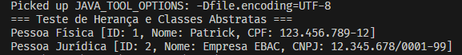

# Exercício EBAC Módulo 13

Neste exercício deverá ser feito:

1. Criar uma classe abstrata Pessoa;
2. Criar 2 subclasses concretas PessoaFisica e PessoaJuridica;
3. As propriedades da subclasse (ex: Nome) precisam estar na classe abstrata;
4. Publicar o exercício no github

## Tecnologias

- Java 11+
- Git
- VSCode

## Resultado

